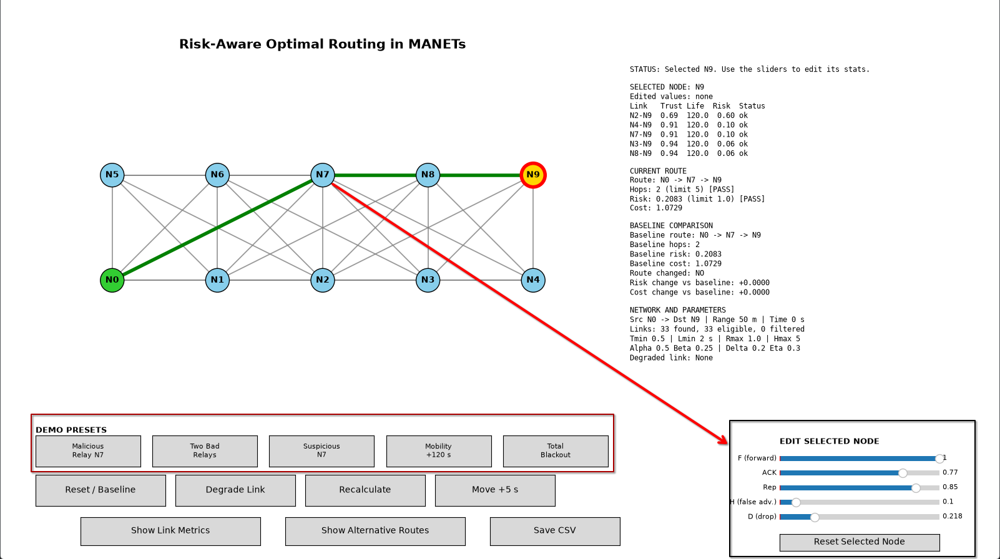

# Risk-Aware Optimal Routing in MANETs

Routing for a Mobile Ad Hoc Network (MANET) that picks a route using **trust, link lifetime and drop rate**, not just hop count.

## What's new in this branch

An interactive **UI** for simulating different network conditions:

- **Sliders** to adjust the values of individual nodes, so you can watch the chosen route change.
- **Presets** for ready-made scenarios, for example:
  - one malicious node (node 7)
  - two malicious nodes

### Screenshots
 |

## How the routing works

1. Compute each link's **trust** from forwarding, acknowledgments, neighbour reputation and route honesty.
2. Remove links with trust below `TMIN` or lifetime below `LMIN`.
3. Give every remaining link a **cost** and a **risk**.
4. List all loop-free routes from source to destination within `HMAX` hops.
5. Reject routes whose total risk is above `RMAX`.
6. Pick the **lowest-cost** route that remains. If none remains, report "no feasible route".

```
Link cost = ALPHA + BETA*(1 - T) + GAMMA*(1/L + D)
Link risk = (1 - T) + DELTA/L + ETA*D
```

T = trust, L = link lifetime, D = drop rate.

## Default settings

| Setting | Value |
|---|---|
| Nodes | 10 (source N0, destination N9) |
| `TMIN` (minimum trust) | 0.50 |
| `LMIN` (minimum lifetime) | 2.0 s |
| `RMAX` (maximum path risk) | 1.0 |
| `HMAX` (maximum hops) | 5 |
| `ALPHA`, `BETA`, `GAMMA` | 0.50, 0.25, 0.25 |
| `DELTA`, `ETA` | 0.20, 0.30 |

## Run

```bash
python risk_aware_manet.py
```

This opens the terminal menu (find best route, show alternatives, degrade a link, move nodes, export CSV, run the full experiment).

To start the UI: `python <ui_file>.py` <!-- TODO: replace with the real UI file name -->

## Files

| File | Purpose |
|---|---|
| `risk_aware_manet.py` | Routing engine and terminal menu |
| `manet_visualization.py` | Visualization of the network and the selected route |
| `<ui_file>.py` | UI with node sliders and presets <!-- TODO --> |
| `risk_aware_link_metrics.csv` | Exported link metrics (created by the program) |

## Example result

With the default network, `N0 -> N7 -> N9` is chosen over `N0 -> N2 -> N9`. Both have 2 hops, but the chosen route has risk 0.21 against 0.80 and cost 1.07 against 1.41.

## Notes

- The search checks every valid route, so it is exact and fast for small networks like this one. It grows quickly for much larger networks.
- Trust values are simulated inputs for the demo.
